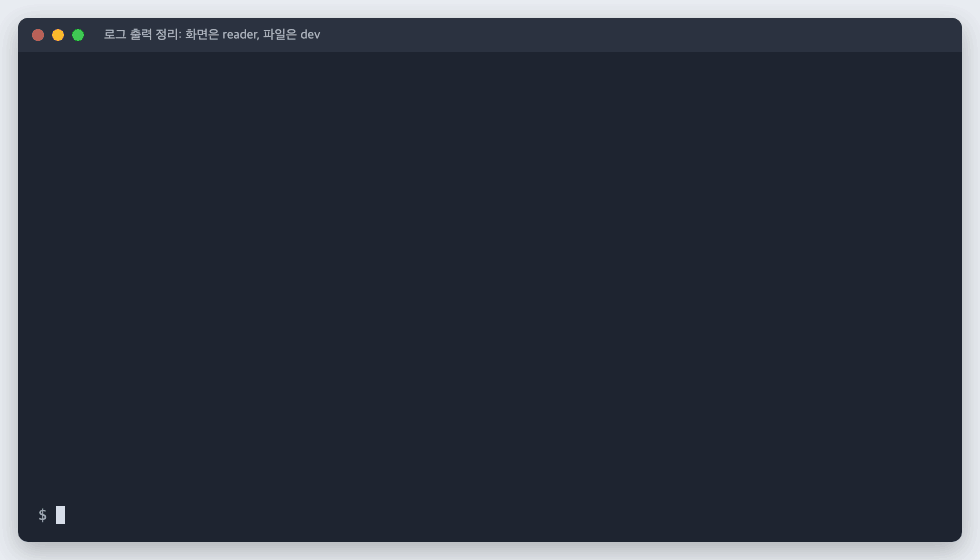
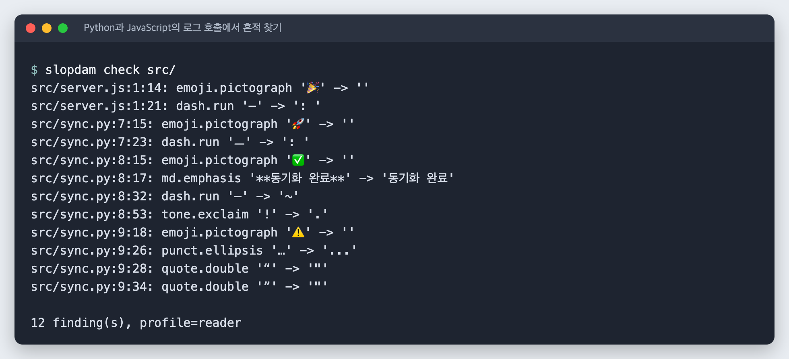
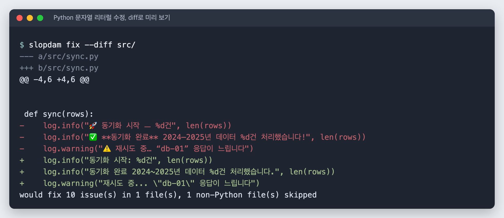
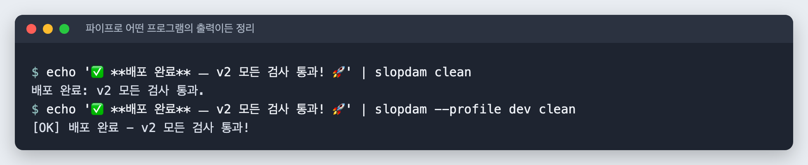

<h1 align="center">slopdam</h1>

<p align="center"><i>로그로 흘러드는 AI slop을 막는 댐: 긴 대시, 이모지, 구분선, 마크다운이 로그에 남지 않게 합니다.</i></p>

<p align="center"><a href="https://github.com/slopdam/slopdam/blob/main/README.md">English</a> | <b>한국어</b></p>

<p align="center">
  <a href="https://github.com/slopdam/slopdam/actions/workflows/ci.yml"></a>
  <a href="https://pypi.org/project/slopdam/"></a>
  <a href="https://pypi.org/project/slopdam/"></a>
  <a href="https://github.com/slopdam/slopdam/blob/main/spec/README.ko.md"></a>
  <a href="https://github.com/slopdam/slopdam/blob/main/LICENSE"></a>
</p>

slopdam은 AI 코딩 도구가 로그 메시지와 콘솔 출력에 남기는 흔적을 걷어냅니다. 긴 대시와 그와 닮은 선(한글 `ㅡ` 포함), 장식 이모지, 구분선, 마크다운 굵은 글씨, 둥근 따옴표, 보이지 않는 문자가 대상입니다. 로그가 출력될 때 정리하고, 커밋하기 전에 소스 코드에서 찾아 고칩니다.

같은 흔적이라도 누가 읽느냐에 따라 다르게 바꿉니다.

```
입력  : ✅ **저장 완료** ㅡ 2024–2025년 데이터 3건 처리했습니다! 🎉
reader: 저장 완료: 2024~2025년 데이터 3건 처리했습니다.
dev   : [OK] 저장 완료 - 2024-2025년 데이터 3건 처리했습니다!
```

- `reader`(기본): 사람이 읽는 글. CLI 메시지, 알림, 보고서에 씁니다.
- `dev`: 검색하기 쉬운 글. 로그 파일과 수집기에 씁니다. 상태 이모지는 지우지 않고 `[OK]`, `[FAIL]`, `[WARN]`으로 바꿉니다.



<sub>샘플 프로젝트에서 <code>scripts/demo/make_demo.py</code>로 실제 실행해 녹화했습니다. 화면의 출력은 모두 slopdam이 실제로 출력한 내용입니다.</sub>

## 주요 기능

- 엔진 하나, 프로필 둘. 탐지는 같고, `reader`는 사람이 읽기 좋은 문장을, `dev`는 도구가 쓰기 좋은 정보를 남깁니다. 로거 하나로 화면에는 `reader`, 파일에는 `dev`를 동시에 보낼 수 있습니다.
- 출력되는 순간 정리합니다. `logging` 포맷터와 필터, structlog 프로세서, loguru 패처를 제공합니다. 핸들러마다 따로 처리하고, 트레이스백은 건드리지 않으며, 구분선뿐인 로그는 버립니다.
- 커밋 전에 찾아냅니다. `slopdam check`는 Python은 문법 트리로, JavaScript, TypeScript, Java, Kotlin, Go, Rust, Ruby, PHP, Swift는 줄 단위로 읽고, 로그와 print 호출만 봅니다.
- Python은 안전하게 고칩니다. `slopdam fix`는 문자열 리터럴 안의 글자만 바꿉니다. 따옴표, 접두어, 이스케이프, f-string 표현식, `%s` 서식 자리는 그대로 두고, 고친 파일이 컴파일되지 않으면 쓰지 않습니다.
- 한국어를 압니다. 한글 `ㅡ`의 세 가지 코드 포인트, 한글 뒤의 `!`를 처리하고, `reader`에서는 숫자 범위를 한국어 표기대로 `~`로 쓰며, 한글, 한자, 가나 본문은 건드리지 않습니다.
- 보수적으로 동작합니다. URL, 인라인 코드, `key=value`의 값, 파일 경로는 보호하고, 날짜, 명령줄 옵션, `__name__`을 흔적으로 착각하지 않습니다. 규칙은 결정적이고, 두 번 정리해도 바뀌지 않는지 속성 기반 테스트로 확인합니다.
- CI에 바로 붙습니다. pre-commit 훅, PR에 주석을 다는 GitHub Action, 코드 스캐닝용 SARIF, JSON 출력, 편집기용 표준 입력 검사를 지원합니다. 모든 결과에는 규칙 ID가 있어 끄거나 줄 단위로 무시할 수 있습니다.
- 다른 언어로 넓힐 준비가 되어 있습니다. 동작은 언어 중립 [명세](https://github.com/slopdam/slopdam/blob/main/spec/README.ko.md)와 적합성 사례로 적혀 있습니다. JavaScript, TypeScript 패키지 [@slopdam/core](https://github.com/slopdam/slopdam/blob/main/js/README.ko.md)는 이미 모든 사례를 통과하고, Go, Java, Rust가 뒤따릅니다([로드맵](https://github.com/slopdam/slopdam/blob/main/ROADMAP.ko.md)).
- 실행 의존성이 없습니다. Python 3.9~3.13, 타입 정보 포함.

## 화면

| 로그 출력 정리 (화면은 reader, 파일은 dev) | Python과 JavaScript에서 흔적 찾기 |
|---|---|
| ![python app.py는 reader 문장을 출력하고, app.log에는 [OK] 태그가 붙은 dev 문장이 남으며, 구분선은 버려진 화면](https://raw.githubusercontent.com/slopdam/slopdam/main/docs/assets/logging-ko.png) |  |
| **Python 문자열 리터럴 수정 미리 보기** | **파이프로 어떤 프로그램의 출력이든 정리** |
|  |  |

## 설치

Python 3.9 이상에서 동작하고, 실행에 필요한 의존성은 없습니다.

```bash
pip install slopdam
```

## 로그 출력 정리

```python
import logging
from slopdam import PlainFilter, PlainFormatter

console = logging.StreamHandler()                    # 사람이 읽는 화면
console.setFormatter(PlainFormatter("%(message)s"))  # reader 프로필
console.addFilter(PlainFilter())                     # 구분선만 찍는 로그는 버림

file = logging.FileHandler("app.log")                # 도구가 읽는 파일
file.setFormatter(PlainFormatter("%(asctime)s %(levelname)s %(message)s", profile="dev"))
file.addFilter(PlainFilter(profile="dev"))

logging.basicConfig(level=logging.INFO, handlers=[console, file])
logging.info("✅ 처리 %s건 ㅡ 완료!", 3)
# 화면    : 처리 3건: 완료.
# app.log : 2026-11-23 ... INFO [OK] 처리 3건 - 완료!
```

- 원본 로그 레코드는 바꾸지 않으므로 핸들러마다 다른 프로필을 쓸 수 있습니다.
- 트레이스백, URL, 인라인 코드, `key=value`의 값, 파일 경로는 건드리지 않습니다.

structlog와 loguru도 같은 방식으로 씁니다. slopdam이 두 라이브러리를 필요로 하지는 않습니다.

```python
from slopdam.integrations.structlog import SlopdamProcessor
structlog.configure(processors=[structlog.processors.add_log_level,
                                SlopdamProcessor(profile="dev"),
                                structlog.processors.JSONRenderer()])

from slopdam.integrations.loguru import SlopdamPatcher
logger = logger.patch(SlopdamPatcher(profile="dev"))
```

structlog 프로세서는 이벤트 메시지만 정리합니다. 다른 필드도 정리하려면 `keys=["note"]`처럼 넘깁니다.

## 소스 코드 검사와 수정

```bash
slopdam check src/                # 로그와 print 호출의 흔적을 알림. 있으면 exit 1
slopdam --profile dev check src/  # 수정안을 dev 방식으로
slopdam fix --diff src/           # Python 문자열 리터럴 수정 미리 보기
slopdam fix src/                  # 실제로 고치기
git diff | slopdam check -        # 표준 입력의 텍스트 검사
cat app.py | slopdam check --stdin-filename app.py -   # 표준 입력을 그 파일처럼 검사
```

```
src/sync.py:8:18: emoji.pictograph '✅' -> ''
src/sync.py:8:25: dash.run 'ㅡ' -> ': '
```

Python 파일은 문법 트리로 읽기 때문에 문자열이 정확히 어디서 시작하고 끝나는지 압니다. `slopdam fix`는 문자열 내용만 고칩니다. 따옴표, 접두어, 이스케이프, f-string 표현식, `%s` 같은 서식 자리는 그대로 두고, 결과가 컴파일되지 않으면 파일을 쓰지 않습니다. 다른 언어는 줄 단위로 검사합니다.

특정 줄을 건너뛰려면 `# slopdam: ignore`를, 규칙 군 하나만 건너뛰려면 `# slopdam: ignore[emoji]`를 붙입니다.

## 설정

`slopdam.toml` 또는 `pyproject.toml`의 `[tool.slopdam]` 표를 읽습니다. 명령줄 옵션이 우선합니다.

```toml
profile = "dev"
level = "basic"
disable = ["emoji.status"]

[lint]
scope = "log-calls"   # log-calls | strings | all
exclude = ["tests/**"]
```

## pre-commit과 CI

```yaml
repos:
  - repo: https://github.com/slopdam/slopdam
    rev: v0.4.1
    hooks:
      - id: slopdam
```

GitHub Actions에서는 발견한 흔적을 PR에 주석(annotation)으로 표시합니다.

```yaml
- uses: actions/checkout@v7
- uses: slopdam/slopdam@v0.4.1
  with:
    paths: src/
```

`slopdam check --format`은 `json`, `github`(워크플로 주석), `sarif`(GitHub 코드 스캐닝 등 SARIF 뷰어)로도 출력합니다.

종료 코드: `0` 깨끗함, `1` 흔적 발견(`fix --diff`에서는 바뀔 내용 있음), `2` 옵션이나 설정 오류.

## 파이프

```bash
tail -f app.log | slopdam clean
```

## 다른 언어

slopdam은 어느 언어에서나 같은 방식으로 동작하도록 만들고 있습니다.

- **지금 가능한 것:** `slopdam check`는 JavaScript, TypeScript, Java, Kotlin, Go, Rust, Ruby, PHP, Swift의 로그와 print 호출을 줄 단위로 검사하고, pre-commit 훅과 GitHub Action도 같은 파일을 다룹니다. `slopdam clean`은 파이프로 어떤 프로그램의 출력이든 정리합니다: `node server.js 2>&1 | slopdam clean --profile dev`
- **언어별 패키지:** 동작은 Python과 별개로 [spec/](https://github.com/slopdam/slopdam/blob/main/spec/README.ko.md)에 정의되어 있습니다. 규칙 목록과, 모든 구현이 통과해야 하는 적합성 사례입니다. JavaScript, TypeScript 패키지 [@slopdam/core](https://github.com/slopdam/slopdam/blob/main/js/README.ko.md)는 `js/`에 있고 모든 사례를 통과합니다. Go, Java, Rust는 [로드맵](https://github.com/slopdam/slopdam/blob/main/ROADMAP.ko.md)에 계획되어 있습니다.

## 규칙

모든 규칙에는 `dash.run`, `emoji.pictograph` 같은 ID가 있고, ID나 군 단위(`--disable emoji`)로 끌 수 있습니다. 프로필은 흔적을 무엇으로 바꿀지를, 레벨은 얼마나 적극적으로 바꿀지를 정합니다. 레벨은 `basic`(기본), `strong`(군더더기 표현도 삭제), `strict`(ASCII 이외의 모든 기호도 보고) 세 가지입니다. 전체 목록은 [docs/RULES.ko.md](docs/RULES.ko.md)에 있습니다.

## 기여

기여를 환영합니다. [CONTRIBUTING.ko.md](CONTRIBUTING.ko.md)를 읽어 주세요. 모든 커밋에는 DCO 서명(`git commit -s`)이 필요합니다. 보안 문제는 [SECURITY.ko.md](SECURITY.ko.md)의 방법으로 비공개 신고해 주세요. 운영 방식은 [GOVERNANCE.ko.md](GOVERNANCE.ko.md), 커뮤니티 규칙은 [행동 강령](CODE_OF_CONDUCT.ko.md)을 따릅니다.

## 라이선스

[MIT](LICENSE). 외부 구성 요소는 [THIRD_PARTY_NOTICES.md](THIRD_PARTY_NOTICES.md)에 있습니다.
