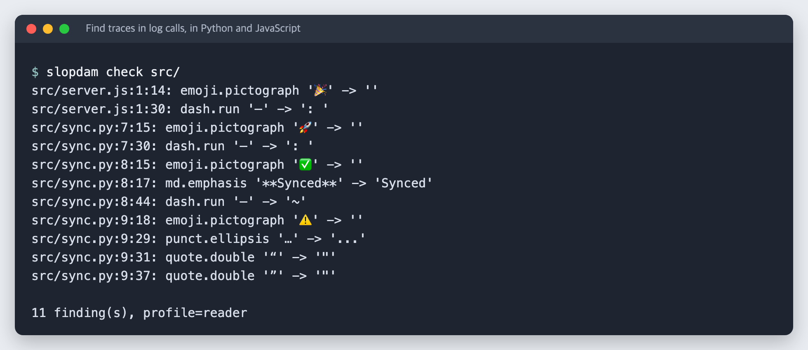
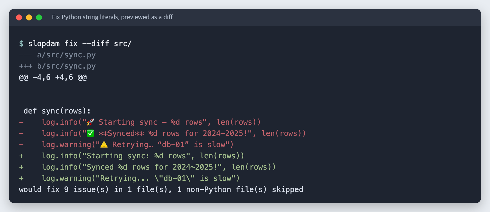
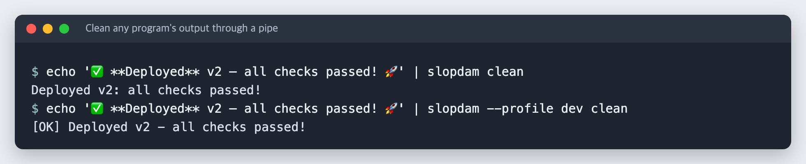
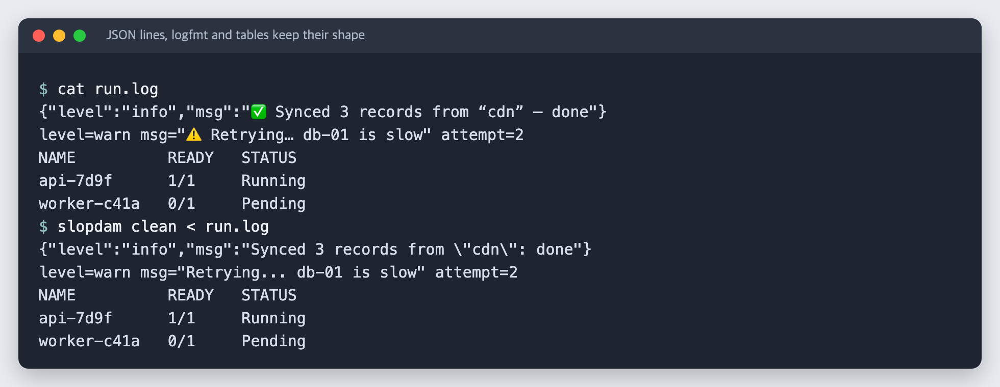

<p align="center">
  
</p>

<h1 align="center">slopdam</h1>

<p align="center"><i>A dam for AI slop: em dashes, emoji, separator lines and markdown stay out of your logs.</i></p>

<p align="center"><b>English</b> | <a href="https://github.com/slopdam/slopdam/blob/main/README.ko.md">한국어</a></p>

<p align="center">
  <a href="https://github.com/slopdam/slopdam/actions/workflows/ci.yml"></a>
  <a href="https://pypi.org/project/slopdam/"></a>
  <a href="https://pypi.org/project/slopdam/"></a>
  <a href="https://github.com/slopdam/slopdam/blob/main/spec/README.md"></a>
  <a href="https://github.com/slopdam/slopdam/blob/main/LICENSE"></a>
</p>

slopdam removes the traces AI coding tools leave in log messages and console output: em dashes and look-alike lines (including the Korean `ㅡ`), decorative emoji, separator lines, markdown bold, curly quotes and invisible characters. It cleans messages as they are written, and finds and fixes them in source code before they are committed.

The same trace becomes different text depending on who reads it:

```
input : ✅ **Saved** — 3 rows processed 🎉
reader: Saved: 3 rows processed
dev   : [OK] Saved - 3 rows processed
```

- `reader` (default): plain text for people, such as CLI messages, alerts and reports.
- `dev`: grep-friendly text for log files and collectors. Status emoji become `[OK]`, `[FAIL]` and `[WARN]` instead of disappearing.


<sub>Recorded from real runs on a sample project with <code>scripts/demo/make_demo.py</code>; every line of output is what slopdam printed.</sub>

## Highlights

- One engine, two profiles. Detection is shared; `reader` writes plain sentences for people and `dev` keeps information for tools. A logger can send `reader` text to the console and `dev` text to a file at the same time.
- Cleans logs as they are written. A `logging` formatter and filter, a structlog processor and a loguru patcher. Each handler gets its own result, tracebacks are never touched, and records that were only a separator line are dropped.
- Keeps structure. In JSON lines and logfmt only the message is cleaned and the line stays valid (a curly quote inside a string becomes `\"`). Tables, aligned columns, stack traces and diffs come out as they went in.
- Finds traces before they are committed. `slopdam check` reads Python through the syntax tree and JavaScript, TypeScript, Java, Kotlin, Go, Rust, Ruby, PHP and Swift line by line, looking only at log and print calls.
- Fixes Python safely. `slopdam fix` rewrites only the text inside string literals. Quotes, prefixes, escapes, f-string expressions and `%s` placeholders stay, and nothing is written unless the file still compiles.
- Korean-aware. The Hangul `ㅡ` in all three of its code points, `!` after Hangul, number ranges written with `~` as in Korean in `reader`, and Hangul, Hanja and kana text left alone.
- Conservative by design. URLs, inline code, `key=value` values (except the message of a logfmt line) and file paths are protected; dates, command line flags and `__name__` are not mistaken for traces. Rules are deterministic, and property-based tests check that cleaning twice changes nothing.
- Fits into CI. pre-commit hook, GitHub Action with pull request annotations, SARIF for code scanning, JSON output and stdin for editors. Every finding has a rule ID you can disable or ignore per line.
- Ready for other languages. The behavior is written down as a language-neutral [spec](https://github.com/slopdam/slopdam/blob/main/spec/README.md) with conformance cases. The JavaScript and TypeScript package [@slopdam/core](https://github.com/slopdam/slopdam/blob/main/js/README.md), the [Go module](https://github.com/slopdam/slopdam/blob/main/go/README.md) and the [Java library](https://github.com/slopdam/slopdam/blob/main/java/README.md) already pass all of them; Rust follows ([roadmap](https://github.com/slopdam/slopdam/blob/main/ROADMAP.md)).
- No runtime dependencies. Python 3.9 to 3.13, typed.

## Screenshots

| Clean log output (reader on the console, dev in the file) | Find traces in Python and JavaScript |
|---|---|
| ![python app.py prints reader text, and app.log holds the dev text with an [OK] tag; the separator line is dropped](https://raw.githubusercontent.com/slopdam/slopdam/main/docs/assets/logging-en.png) |  |
| **Preview fixes to Python string literals** | **Clean any program's output in a pipe** |
|  |  |
| **Keep JSON lines, logfmt and tables intact** | **Try it in the browser** |
|  | [huggingface.co/spaces/slopdam/slopdam](https://huggingface.co/spaces/slopdam/slopdam): paste a log message and see the `reader` and `dev` output and every trace, with nothing sent to a server |

## Install

slopdam needs Python 3.9 or later and has no runtime dependencies.

```bash
pip install slopdam
```

## Clean log output

```python
import logging
from slopdam import PlainFilter, PlainFormatter

console = logging.StreamHandler()                    # read by people
console.setFormatter(PlainFormatter("%(message)s"))  # reader profile
console.addFilter(PlainFilter())                     # drop lines that were only separators

file = logging.FileHandler("app.log")                # read by tools
file.setFormatter(PlainFormatter("%(asctime)s %(levelname)s %(message)s", profile="dev"))
file.addFilter(PlainFilter(profile="dev"))

logging.basicConfig(level=logging.INFO, handlers=[console, file])
logging.info("✅ Synced %s rows — done", 3)
# console: Synced 3 rows: done
# app.log: 2026-11-23 ... INFO [OK] Synced 3 rows - done
```

- The original log record is never modified, so each handler can use its own profile.
- Tracebacks, URLs, inline code, `key=value` values and file paths are left untouched.

structlog and loguru work the same way. Neither library is required by slopdam.

```python
from slopdam.integrations.structlog import SlopdamProcessor
structlog.configure(processors=[structlog.processors.add_log_level,
                                SlopdamProcessor(profile="dev"),
                                structlog.processors.JSONRenderer()])

from slopdam.integrations.loguru import SlopdamPatcher
logger = logger.patch(SlopdamPatcher(profile="dev"))
```

The structlog processor cleans the event message only; pass `keys=["note"]` to clean other fields too.

## Lint and fix source code

```bash
slopdam check src/                # report traces in log and print calls; exit 1 if any
slopdam --profile dev check src/  # suggestions in the dev style
slopdam fix --diff src/           # preview fixes to Python string literals
slopdam fix src/                  # apply them
git diff | slopdam check -        # check text from stdin
cat app.py | slopdam check --stdin-filename app.py -   # stdin, checked like that file
```

```
src/sync.py:8:18: emoji.pictograph '✅' -> ''
src/sync.py:8:25: dash.run 'ㅡ' -> ': '
```

Python files are read through the syntax tree, so slopdam knows exactly where each string starts and ends. `slopdam fix` changes only the literal text: quotes, prefixes, escape sequences, f-string expressions and placeholders such as `%s` stay as they are, and nothing is written unless the result compiles. Other languages are checked line by line.

To skip a line, add `# slopdam: ignore`, or `# slopdam: ignore[emoji]` to skip one rule group.

## Configuration

slopdam reads `slopdam.toml`, or the `[tool.slopdam]` table in `pyproject.toml`. Command line options take precedence.

```toml
profile = "dev"
level = "basic"
disable = ["emoji.status"]

[lint]
scope = "log-calls"   # log-calls | strings | all
exclude = ["tests/**"]
```

## pre-commit and CI

```yaml
repos:
  - repo: https://github.com/slopdam/slopdam
    rev: v0.7.0
    hooks:
      - id: slopdam
```

GitHub Actions, with findings shown as annotations on the pull request:

```yaml
- uses: actions/checkout@v7
- uses: slopdam/slopdam@v0.7.0
  with:
    paths: src/
```

`slopdam check --format` also writes `json`, `github` (workflow annotations) and `sarif` (GitHub code scanning and other SARIF viewers).

Exit codes: `0` clean, `1` traces found (or `fix --diff` has changes), `2` usage or configuration error.

## Pipe

```bash
tail -f app.log | slopdam clean
```

## Other languages

slopdam is built to work the same way in every language.

- **Now:** `slopdam check` lints log and print calls in JavaScript, TypeScript, Java, Kotlin, Go, Rust, Ruby, PHP and Swift line by line, and the pre-commit hook and GitHub Action cover the same files. `slopdam clean` cleans the output of any program through a pipe: `node server.js 2>&1 | slopdam clean --profile dev`.
- **Native packages:** the behavior is defined independently of Python in [spec/](https://github.com/slopdam/slopdam/blob/main/spec/README.md): the rule catalog and conformance cases that every port must pass. The JavaScript and TypeScript package [@slopdam/core](https://github.com/slopdam/slopdam/blob/main/js/README.md) lives in `js/` and the Go module [github.com/slopdam/slopdam/go](https://github.com/slopdam/slopdam/blob/main/go/README.md) in `go/`; the Java library [io.github.slopdam:slopdam](https://github.com/slopdam/slopdam/blob/main/java/README.md) in `java/`; all of them pass every case. Rust is planned in the [roadmap](https://github.com/slopdam/slopdam/blob/main/ROADMAP.md).

## Rules

Every rule has an ID such as `dash.run` or `emoji.pictograph`, and can be turned off by ID or by group (`--disable emoji`). Profiles decide what a trace becomes, and levels decide how far slopdam goes: `basic` (default), `strong` (also removes filler words) and `strict` (also reports any non-ASCII symbol). See [docs/RULES.md](https://github.com/slopdam/slopdam/blob/main/docs/RULES.md) for the full catalog.

## Contributing

Contributions are welcome. Please read [CONTRIBUTING.md](https://github.com/slopdam/slopdam/blob/main/CONTRIBUTING.md); every commit needs a DCO sign-off (`git commit -s`). Report security issues privately as described in [SECURITY.md](https://github.com/slopdam/slopdam/blob/main/SECURITY.md). Project decisions follow [GOVERNANCE.md](https://github.com/slopdam/slopdam/blob/main/GOVERNANCE.md), and the community follows the [Code of Conduct](https://github.com/slopdam/slopdam/blob/main/CODE_OF_CONDUCT.md).

## License

[MIT](https://github.com/slopdam/slopdam/blob/main/LICENSE). Third-party components are listed in [THIRD_PARTY_NOTICES.md](https://github.com/slopdam/slopdam/blob/main/THIRD_PARTY_NOTICES.md).
